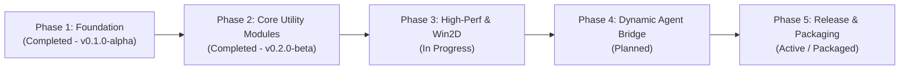

# OmniForge Utility Suite

<div align="center">


### *Modular, High-Performance Windows 11 Utility Suite & Developer Toolset*

[](https://dotnet.microsoft.com/)
[-0078D4?style=for-the-badge&logo=windows&logoColor=white)](https://learn.microsoft.com/en-us/windows/apps/windows-app-sdk/)
[](https://learn.microsoft.com/en-us/dotnet/csharp/)
[](https://learn.microsoft.com/en-us/windows/apps/design/style/mica)
[](tests/OmniForge.Tests)
[](installer/OmniForge.iss)
[](LICENSE)

</div>

---

## 📑 Table of Contents

- [🌟 Executive Overview](#-executive-overview)
- [🛠️ Feature Modules](#️-feature-modules)
- [📐 Architecture & Core Principles](#-architecture--core-principles)
- [📁 Repository Structure](#-repository-structure)
- [⚡ Quick Start & Prerequisites](#-quick-start--prerequisites)
- [💻 Developer CLI Workflow (`.\forge`)](#-developer-cli-workflow-forge)
- [📦 Packaging & Distribution Pipeline](#-packaging--distribution-pipeline)
- [🤖 Autonomous AI Agent Skills Ecosystem](#-autonomous-ai-agent-skills-ecosystem)
- [🧪 Testing & Quality Assurance](#-testing--quality-assurance)
- [🗺️ Roadmap & Milestones](#️-roadmap--milestones)
- [🤝 Contributing & Governance](#-contributing--governance)
- [📄 License](#-license)

---

## 🌟 Executive Overview

**OmniForge** is a modular, high-performance desktop utility suite engineered for Windows 11 and modern Windows 10 (1809+). Built from the ground up with **.NET 9**, **WinUI 3 (Windows App SDK 1.6)**, and **Modular Clean Architecture**, OmniForge consolidates disparate, bloated single-purpose developer utilities into an integrated, ultra-responsive workstation experience.

OmniForge brings together **17 specialized AI Agent skills**, compile-time MVVM source generation, zero-allocation cryptographic streams, hardware-accelerated Win2D canvas rendering, and a self-contained Inno Setup packaging pipeline.

```
                      ┌───────────────────────────────────────┐
                      │        OmniForge WinUI 3 Shell        │
                      │  (MicaAlt Backdrop · Waffle Launcher) │
                      └──────────────────┬────────────────────┘
                                         │
     ┌──────────────────┬────────────────┼─────────────────┬──────────────────┐
     ▼                  ▼                ▼                 ▼                  ▼
┌──────────────┐ ┌──────────────┐ ┌──────────────┐ ┌──────────────┐ ┌────────────────┐
│ Batch Rename │ │ Checksum Lab │ │ Payload View │ │ Folder Maker │ │ Win2D Wheel    │
│ ReDoS Regex  │ │ SHA-256/MD5  │ │ JSON/JWT/XML │ │ Excel/Series │ │ 60+ FPS Canvas │
│ Undo Journal │ │ Zero-Alloc   │ │ Text Diffing │ │ Tree ASCII   │ │ Physics Easing │
└──────────────┘ └──────────────┘ └──────────────┘ └──────────────┘ └────────────────┘
```

---

## 🛠️ Feature Modules

All utilities inside OmniForge implement `IToolModule` and are dynamically discovered at runtime via `ModuleAutoDiscoveryExtensions`:

| Module | Identifier | Description | Highlights |
| :--- | :--- | :--- | :--- |
| **📁 Batch Renamer** | `BatchRename` | High-throughput file & path renaming engine | ReDoS-safe regex, dynamic token interpolation (`{index}`, `{date}`), live diff preview, and transactional undo journal. |
| **🔒 Checksum Lab** | `Checksum` | File & text cryptographic digest validator | Zero-allocation streaming via `ArrayPool<byte>`, multi-hash support (SHA-256/512, MD5), drag-and-drop comparison, `.sha256` export. |
| **🔍 Payload Inspector** | `TextInspector` | Developer text, payload, and schema analyzer | Formatter/minifier for JSON & XML, Base64/URL/Hex converter, decoded JWT claim inspector, and line-by-line visual diffing. |
| **📂 Batch Folder Maker** | `BatchFolder` | Directory hierarchy scaffolding tool | Smart import from Excel (`.xlsx`), CSV, TSV, or plain text; numbered sequence generator; ASCII tree preview; path traversal sanitization. |
| **🎡 Lucky Wheel** | `LuckyWheel` | High-FPS decision selector & visualizer | Direct2D/DirectWrite hardware acceleration via Win2D `CanvasControl`, realistic physics deceleration, customizable weights and palettes. |
| **📊 Suite Dashboard** | `Dashboard` | Workstation telemetry & quick launcher | Global Waffle App Launcher (`\uED35`), categorized module filtering (Batch, Security, Text, Graphics), and system environment metrics. |
| **⚙️ Settings & Updates** | `Settings` | Workspace preferences & auto-update client | Fluent theme selection (Light, Dark, System MicaAlt), decoupled `IUpdateService` with SemVer checks, streaming installer downloads, and SHA-256 verification. |

---

## 📐 Architecture & Core Principles

OmniForge enforces strict unidirectional dependency flow across its modular layers:

```
[ OmniForge.App ] (Presentation, WinUI 3 Views, ViewModels, Composition Root)
       │
       ▼
[ OmniForge.Services ] (NavigationService, LocalSettingsService, FileSystemService, UpdateService)
       │
       ▼
[ OmniForge.Core ] (IToolModule, Result<T>, Error, SecurityGuard, Domain Models)
```

### Architectural Principles

1. **Strict Dependency Hierarchy**:
   - `OmniForge.Core`: Pure domain abstractions, contracts (`IToolModule`), functional results (`Result<T>`), and common helpers. Zero UI or Windows App SDK dependencies.
   - `OmniForge.Services`: Cross-cutting implementations (settings persistence, file system utilities, update coordination). References `OmniForge.Core` only.
   - `OmniForge.App`: Presentation layer and composition root. Hosts `App.xaml`, `MainWindow`, ViewModels, and views.
2. **Zero Code-Behind MVVM Discipline**:
   - Code-behind files (`*.xaml.cs`) are restricted strictly to component initialization (`InitializeComponent()`), DI ViewModel injection, and window chrome integration. Zero business logic or data transformations.
   - Compile-time `{x:Bind}` with explicit binding modes (`OneWay`/`TwoWay`).
   - ViewModels derive from `ToolViewModelBase` (or `ObservableObject`) using `CommunityToolkit.Mvvm` source generators (`[ObservableProperty]`, `[RelayCommand]`).
3. **Asynchronous & Non-Blocking File I/O**:
   - Zero synchronous disk calls (`File.ReadAllText`, `Directory.GetFiles`) on or near UI threads.
   - Mandatory `CancellationToken` propagation across all asynchronous pipelines.
   - Chunked streaming and buffer pooling via `IAsyncEnumerable<T>` and `ArrayPool<byte>.Shared`.
4. **Fault Tolerance & Crash Isolation**:
   - Functional `Result` and `Result<T>` pattern for anticipated operational errors, avoiding thrown exceptions.
   - Per-module fault isolation: module runtime failures display localized status infobars without crashing `MainWindow`.
5. **Unified Distribution Directory (`release/`)**:
   - Centralized release artifacts (`release/publish/`, `release/installer/`, `release/checksums.txt`) adhering to automated packaging and integrity standards.

---

## 📁 Repository Structure

```text
OmniForge/
├── .agents/                                # AI Agent system governance, rules, and skills
│   ├── AGENTS.md                           # Master system architecture & operational protocol
│   ├── rules/                              # Specialized architectural rule sets
│   └── skills/                             # 17 Antigravity AI Agent skills
├── docs/                                   # Architecture blueprints & roadmaps
│   ├── ARCHITECTURE.md                     # Deep architectural specifications
│   └── ROADMAP.md                          # 5-phase milestone breakdown
├── installer/                              # Production installer automation
│   └── OmniForge.iss                       # Inno Setup 6 compiler configuration
├── release/                                # Unified distribution directory
│   ├── publish/win-x64/                    # Published self-contained binaries
│   ├── installer/                          # Windows Setup executable (OmniForge-Setup-v*.exe)
│   ├── portable/                           # Portable ZIP distributions
│   └── checksums.txt                       # Cryptographic SHA-256 integrity hashes
├── src/
│   ├── OmniForge.Core/                     # Pure domain layer (contracts, models, Result<T>)
│   ├── OmniForge.Services/                 # Service implementations (Settings, Nav, I/O)
│   └── OmniForge.App/                      # WinUI 3 presentation layer & module pages
├── tests/
│   └── OmniForge.Tests/                    # 143 xUnit & NetArchTest architecture test suites
├── forge.ps1                               # Unified root CLI task runner (.\forge)
├── package.bat                             # Modernized visual ANSI packaging script
├── Directory.Build.props                   # Global compiler flags & nullability rules
├── CHANGELOG.md                            # Keep a Changelog compliant release history
└── README.md                               # Project documentation
```

---

## ⚡ Quick Start & Prerequisites

### System Requirements

- **Operating System**: Windows 11 (21H2+) or Windows 10 (1809+, build 17763+).
- **Windows Developer Mode**: Enabled in *Windows Settings → System → For developers*.

### Developer Tooling

1. **.NET 9 SDK**: Version `9.0.100` or later ([Download .NET 9](https://dotnet.microsoft.com/download/dotnet/9.0)).
2. **Visual Studio 2022** (v17.10+) or **VS Code** with C# Dev Kit:
   - Workload: *.NET Desktop Development*
   - Component: *Windows App SDK C# Templates*
3. **Inno Setup 6**: Version 6.2+ ([Download Inno Setup](https://jrsoftware.org/isdl.php)) for packaging installer executables.

### Setup Instructions

```powershell
# 1. Clone the repository
git clone https://github.com/OmniForge/OmniForge.git
cd OmniForge

# 2. Verify environment & architectural guardrails
.\forge doctor

# 3. Execute the automated test suite (143/143 tests passing)
.\forge test

# 4. Launch the OmniForge WinUI 3 application
.\forge run
```

---

## 💻 Developer CLI Workflow (`.\forge`)

OmniForge includes a unified root CLI task runner (`forge.ps1`), eliminating directory hopping and manual command chaining:

| Category | Command | Description |
| :--- | :--- | :--- |
| **Quality & Audit** | `.\forge verify` | Complete quality gate: static architecture guardrails + build + test suite. |
| | `.\forge arch` | Sub-second (< 1s) static architectural rule scanner. |
| | `.\forge doctor` | Audit .NET SDK version, installed AI skills, and governance rules. |
| **Build & Run** | `.\forge build` | Compile the full solution (`Debug \| x64`, `TreatWarningsAsErrors`). |
| | `.\forge run` | Launch the OmniForge desktop shell directly. |
| | `.\forge clean` | Purge all `bin/` and `obj/` output folders. |
| **Testing** | `.\forge test` | Run all 143 unit and NetArchTest architecture tests. |
| | `.\forge test -Filter "<Name>"` | Execute a targeted test fixture or method. |
| **Scaffolding** | `.\forge new-module <Name>` | Scaffold a new Clean Architecture module (Page, ViewModel, Service, Tests). |
| | `.\forge new-test <Name>` | Generate a deterministic xUnit test class. |
| | `.\forge new-skill <Name>` | Scaffold a 4-part AI Agent Skill under `.agents/skills/`. |
| | `.\forge distill-issue <Name>` | Distill a diagnosed bug and fix into an autonomous agent skill. |
| **Diagnostics** | `.\forge learn "<Insight>"` | Persist architectural rules to `.agents/MEMORY.md`. |
| | `.\forge logs -Tail 30` | Stream real-time JSONL runtime telemetry logs. |
| **Distribution** | `.\forge publish -Platform x64` | Publish self-contained binaries to `release\publish\`. |
| | `.\forge package -Platform x64` | Build, package Inno Setup installer, and generate SHA-256 hash. |

---

## 📦 Packaging & Distribution Pipeline

OmniForge delivers production packages via a unified distribution workflow:

```
release/
├── publish/win-x64/        # Published self-contained application binaries
├── installer/              # Windows Setup Executable (OmniForge-Setup-v*.exe)
├── portable/               # Standalone portable ZIP archives
└── checksums.txt           # Authoritative SHA-256 verification signatures
```

### Visual One-Click Packager (`package.bat`)

For an automated, color-coded terminal packaging experience with prerequisite detection:

```cmd
.\package.bat
```

The script:
1. Validates the .NET 9 SDK and Inno Setup 6 compiler installation.
2. Compiles self-contained binaries to `release\publish\win-x64\`.
3. Verifies compiled XAML (`.xbf`) and Package Resource Index (`resources.pri`) integrity.
4. Generates `OmniForge-Setup-v{Version}.exe` in `release\installer\`.
5. Computes and records cryptographic SHA-256 hashes in `release\checksums.txt`.

---

## 🤖 Autonomous AI Agent Skills Ecosystem

OmniForge incorporates 17 specialized AI Agent skills compliant with the [Antigravity Skill Specification](https://antigravity.google/docs/skills/):

```
.agents/skills/
├── Architecture & Quality
│   ├── cli-task-runner                    # Unified root terminal CLI workflow (.\forge)
│   ├── unit-test-scaffolder               # Deterministic xUnit and NetArchTest generator
│   ├── crash-resilience-and-fault-isolation # Defensive coding, crash isolation, safe UI threading
│   └── security-and-input-hardening       # Defense against ReDoS, path traversal, XML DoS
├── Data & Cryptography
│   ├── crypto-hash-engine                 # Zero-allocation streaming hashing (SHA-256/512, MD5)
│   ├── batch-io-processor                 # Chunked, cancellable batch file processing
│   ├── regex-bulk-renamer                 # Safe regex renaming, token interpolation, undo journal
│   └── text-payload-inspector             # JSON/XML formatting, minification, Base64/JWT, diffing
├── UI & Rendering
│   ├── winui3-module-generator            # Auto-scaffolding of IToolModule plugins
│   ├── fluent-ui-design-system            # Fluent Design brush tokens, typography, Segoe icons
│   ├── win2d-canvas-renderer              # Hardware-accelerated 60+ FPS Win2D CanvasControl
│   ├── performance-and-memory-optimization # Span<T>, ArrayPool<byte>, UI virtualization
│   └── reusable-code-and-ui-architecture  # DRY catalog of shared helpers and controls
└── Automation & Governance
    ├── msix-release-packager              # Trimming-safe publishing & installer packaging
    ├── issue-skill-distiller              # Autonomous packaging of diagnosed bugs into skills
    ├── changelog-curator                  # Keep a Changelog curation and noise elimination
    └── token-efficient-coding             # Ultra-compact C# 13 and XAML patterns (saving 40-65% tokens)
```

---

## 🧪 Testing & Quality Assurance

Quality is enforced through compiler-level guardrails and automated test suites:

- **Compiler Constraints**: `<TreatWarningsAsErrors>true</TreatWarningsAsErrors>` and `<Nullable>enable</Nullable>` enforced globally via `Directory.Build.props`.
- **Architectural Boundary Enforcement**: `NetArchTest.Rules` guarantees that:
  - `OmniForge.Core` has zero dependencies on upper layers.
  - `OmniForge.Services` never references `OmniForge.App`.
  - ViewModels strictly inherit from `ToolViewModelBase` or `ObservableObject`.
- **Domain & Service Verification**: 143 deterministic unit tests covering regex timeouts, path sanitization, hashing accuracy, JSON serialization, and undo journal transactions.
- **Fast Static Guardrail Scanner**: `.\forge arch` scans code-behind files in under 1 second for illegal synchronous I/O.

```powershell
# Run all tests via dotnet CLI
dotnet test tests/OmniForge.Tests/OmniForge.Tests.csproj --nologo -v minimal
```

---

## 🗺️ Roadmap & Milestones



| Phase | Milestone | Focus Area | Status | Deliverables |
| :--- | :--- | :--- | :---: | :--- |
| **Phase 1** | `v0.1.0-alpha` | **Foundation & Architecture** | **Done** | Modular Clean Architecture, MicaAlt shell, `IToolModule` auto-discovery, decoupled navigation, static guardrails. |
| **Phase 2** | `v0.2.0-beta` | **Batch & Developer Utilities** | **Done** | Advanced Regex Bulk Renamer, Checksum Lab, Text & Payload Inspector, Batch Folder Maker. |
| **Phase 3** | `v0.3.0-preview` | **High-Perf Graphics & Win2D** | **In Progress** | Hardware-accelerated Lucky Wheel (60+ FPS), sprite packager & storage treemap visualizer. |
| **Phase 4** | `v0.4.0-rc` | **Agent Bridge & Sandboxing** | **Planned** | External `AssemblyLoadContext` plugin sandbox, command palette (`Ctrl+Shift+P`), local IPC bridge. |
| **Phase 5** | `v1.0.0-rtm` | **Distribution & Hardening** | **Active** | Production Inno Setup installer, SHA-256 signatures, `package.bat`, unified `release/` pipeline. |

---

## 🤝 Contributing & Governance

Contributions to OmniForge are governed by established architectural standards:

1. **Protocol Compliance**: Review [`.agents/AGENTS.md`](.agents/AGENTS.md) before submitting code changes.
2. **Quality Gate**: Ensure `.\forge verify` passes with 100% test success and zero compiler warnings.
3. **Changelog Curation**: Document additions and fixes in [`CHANGELOG.md`](CHANGELOG.md) under `[Unreleased]` following [Keep a Changelog](https://keepachangelog.com/) format.
4. **Autonomous Skill Evolution**: Package recurring technical solutions into new skills via `.\forge distill-issue <Name>`.

---

## 📄 License

OmniForge is open-source software licensed under the **[MIT License](LICENSE)**.

<div align="center">

Crafted with ❤️ by the **OmniForge Contributors** · Designed for Windows 11 Fluent Workstations

</div>
