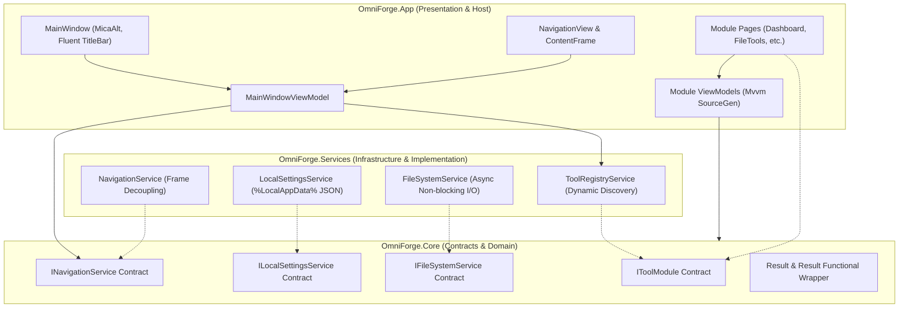
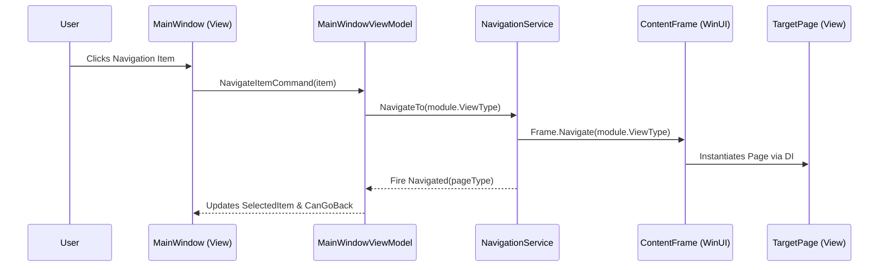

# OmniForge System Architecture & Engineering Blueprint

This document details the architectural design, plugin subsystem, dynamic navigation model, inversion of control container, and state management strategies powering the **OmniForge Utility Suite**.

---

## 1. High-Level Architectural Overview

OmniForge is engineered following **Clean Architecture** and **Plugin-First Modular Design** principles, ensuring low coupling and high testability across .NET 9 and the Windows App SDK (WinUI 3).



---

## 2. Decoupled Plugin Subsystem (`IToolModule`)

OmniForge tools operate as independent modular plugins. Each module registers metadata, view types, and dependencies without requiring hardcoded navigation logic in the shell.

### 2.1 The `IToolModule` Contract
```csharp
namespace OmniForge.Core.Contracts;

public interface IToolModule
{
    string Id { get; }
    string DisplayName { get; }
    string Description { get; }
    string IconGlyph { get; }
    Type ViewType { get; }
    Type ViewModelType { get; }
    int Priority { get; }
    bool IsEnabled => true;
}
```

### 2.2 Lifecycle & Dynamic Tool Discovery
1. **Module Registration**: Built-in and dynamically discovered modules are registered during application startup inside `ServiceCollectionExtensions`.
2. **Registry Aggregation**: `IToolRegistryService` maintains an ordered dictionary of modules sorted by `Priority`.
3. **Reactive UI Updates**: When modules are enabled, disabled, or added, `ModulesChanged` event notifies `MainWindowViewModel`, which dynamically refreshes `NavigationView.MenuItemsSource`.

---

## 3. Dynamic Navigation & Frame Decoupling

In traditional WinUI 3 applications, ViewModels often suffer from tight coupling to UI controls like `Microsoft.UI.Xaml.Controls.Frame`. OmniForge strictly decouples this via `INavigationService`.

### 3.1 Contract Separation
- **`INavigationService`**: Exposes navigation intents (`NavigateTo(string pageKey)`, `NavigateTo(Type pageType)`, `GoBack()`, `CanGoBack`, and `Navigated` events) directly consumable by ViewModels in `OmniForge.Core`.
- **`NavigationService` Implementation**: Encapsulates the UI `Frame` instance, manages the back stack, handles parameter passing, and fires lifecycle notifications.



---

## 4. Inversion of Control (IoC) & Composition Root

OmniForge uses `Microsoft.Extensions.DependencyInjection` as its host container configured within `App.xaml.cs`.

### 4.1 Service Lifetime Standard
- **Singleton**:
  - `INavigationService`: Global window frame coordinator.
  - `IToolRegistryService`: Application-wide plugin catalog.
  - `ILocalSettingsService`: Persistent configuration manager.
  - `IFileSystemService`: Stateless async I/O worker.
  - `MainWindow` & `MainWindowViewModel`: Shell window and navigation controller.
- **Transient**:
  - Feature ViewModels (`DashboardViewModel`, `FileToolsViewModel`, `SettingsViewModel`).
  - Feature Pages (`DashboardPage`, `FileToolsPage`, `SettingsPage`). Transient lifetime ensures clean state resets upon page switching unless explicit caching is configured.

---

## 5. State Management & Configuration Persistence

1. **Persistent State**:
   - Stored in `%LocalAppData%\OmniForge\settings.json`.
   - Thread-safe serialization via `SemaphoreSlim` and `System.Text.Json`.
   - Keys are organized hierarchically: `General.Theme`, `FileTools.LastSelectedDirectory`, etc.
2. **Volatile Session State**:
   - Kept in ViewModel observable properties.
   - For long-running batch operations or cross-module messaging, the `CommunityToolkit.Mvvm.Messaging.WeakReferenceMessenger` is employed for loosely-coupled message broadcast.
3. **Functional Result Envelope**:
   - All async calls returning data wrap responses inside `Result<T>`:
     - `result.IsSuccess` indicates operational validity.
     - `result.Value` provides typed payload.
     - `result.Error` exposes error code and human-readable diagnostic messages without throwing unhandled exceptions.

