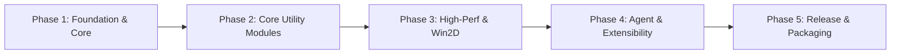

# OmniForge Utility Suite - Master Product Roadmap

This roadmap outlines the 5-phase engineering progression of **OmniForge Utility Suite**, evolving from the architectural core to enterprise-grade production distribution.

---

---

## Phase 1: Foundation, Governance & Architectural Core (Current)
*Target Milestone: v0.1.0-alpha*

- [x] **Agent Governance & Rules Framework**:
  - Master architectural protocol (`.agents/AGENTS.md`).
  - Specialized rule sets for WinUI 3, Clean Code, and Non-blocking Async I/O.
  - Antigravity AI Agent Skills (`winui3-module-generator`, `batch-io-processor`, `win2d-canvas-renderer`).
- [x] **Clean Architecture Solution Scaffold**:
  - Multi-project structure (`OmniForge.Core`, `OmniForge.Services`, `OmniForge.App`).
  - Strict global compilation flags (`Directory.Build.props`: `<Nullable>enable</Nullable>`, `<TreatWarningsAsErrors>true</TreatWarningsAsErrors>`).
  - Core domain contracts (`IToolModule`, `INavigationService`, `ILocalSettingsService`, `Result<T>`).
- [x] **WinUI 3 Fluent Shell**:
  - MicaAlt backdrop system integration.
  - Custom TitleBar with deep window chrome extension.
  - Decoupled `NavigationService` and dynamic `NavigationView` binding.
  - Local JSON settings persistence in `%LocalAppData%`.

---

## Phase 2: Essential Utility Modules & Batch Workflows
*Target Milestone: v0.2.0-beta*

- [ ] **Batch File & Path Renamer**:
  - Regex-based bulk renaming, token substitutions (`{index}`, `{date}`, `{parent}`).
  - Live preview diff grid before executing changes.
  - Chunked asynchronous processing with progress reporting and undo journal.
- [ ] **File Hash & Integrity Validator**:
  - Multi-threaded checksum computation (MD5, SHA-256, SHA-512, BLAKE3).
  - Drag-and-drop file target comparison.
  - Verification against standard `.sha256` checksum lists.
- [ ] **Text & Payload Inspector**:
  - Real-time JSON, XML, YAML validation, formatting, and minification.
  - Base64, JWT, and URL encoder/decoder.
  - Side-by-side visual text diff utility.

---

## Phase 3: High-Performance Graphics & Win2D Visualizers
*Target Milestone: v0.3.0-preview*

- [ ] **Image Asset & Sprite Sheet Optimizer**:
  - Win2D accelerated image resampling, format conversion (PNG, JPEG, WebP, AVIF).
  - Sprite sheet packing with real-time interactive preview.
  - Lossless metadata stripping and EXIF inspection.
- [ ] **System Hardware & Storage Visualizer**:
  - Interactive disk usage treemap using `CanvasControl`.
  - Memory consumption timeline with 60 FPS animated rendering loop.
  - Fast disk sector scanning with cancellation and pause/resume support.

---

## Phase 4: Dynamic Agent & Plugin Extensibility Engine
*Target Milestone: v0.4.0-rc*

- [ ] **External Plugin Host (.NET Assembly Isolation)**:
  - Dynamic module loading via `AssemblyLoadContext` without restarting the app.
  - Sandboxed execution with security validation and permission manifests.
  - Third-party plugin SDK distribution package (`OmniForge.PluginSdk`).
- [ ] **Antigravity AI Agent Bridge**:
  - In-app execution and automation of agent skills via local IPC.
  - Semantic command palette (Ctrl+Shift+P) for natural language tool invocation.
  - Automated diagnostic reporting and workflow generation.

---

## Phase 5: Hardening, Packaging & Production Distribution
*Target Milestone: v1.0.0-rtm*

- [ ] **Packaging & Store Delivery**:
  - Single-project MSIX packaging for Windows 10/11 x64 and ARM64.
  - Standalone unpacked portable distribution option (`win-x64` self-contained).
  - Code signing with EV digital certificate and Windows Developer Store submission.
- [ ] **Continuous Integration & Automated Testing**:
  - GitHub Actions CI pipeline running unit tests, integration tests, and static analysis.
  - Automated release notes generation from `CHANGELOG.md`.
  - Performance regression benchmarks for batch operations.

